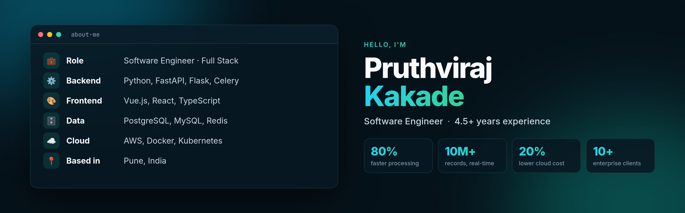

  

  
  
  
  

## Hi there 👋, I'm Pruthviraj

Software engineer from **Pune, India** with **4.5+ years** of experience building scalable full stack web applications, with a strong backend focus in **Python (FastAPI, Flask)** and frontends in **Vue.js and React**. I like making slow things fast, and making systems that keep working when parts of them fail.

- 💼 Currently building data-heavy forecasting and pipeline views for an **enterprise AI revenue platform**, working with a US-based client team
- ⚙️ On the backend: async APIs, background job systems, caching and database performance
- 🎨 On the frontend: data-heavy dashboards and interactive UIs with Vue 3 and React
- 🧠 Recently building with **LLMs and RAG** (LangChain, ChromaDB, OpenAI / Ollama)
- 🌱 Currently going deeper into **Kubernetes, Terraform and AWS**
- 💬 Ask me about **FastAPI, Celery, Redis, PostgreSQL, Vue.js** or system design
- 🌐 Portfolio: **[pruthvi300.github.io](https://pruthvi300.github.io)**
- 📫 Reach me at **pruthvi3.pk@gmail.com**
- 🏐 Outside of code: volleyball and travelling
- 🗣️ I speak English, Hindi and Marathi

## 🚀 Highlights from my professional work

- ⚡ Rewrote a legacy calculation engine with Pandas vectorization: **1M+ records in under 3 minutes instead of 15** (80% faster)
- 📊 Designed a hybrid **MySQL (OLTP) + ClickHouse (OLAP)** setup for **sub-second dashboards over 10M+ rows**
- 💰 Split a monolith into separate queue workers with per-country isolation, cutting **cloud costs by 20%**
- 🧊 Added multi-level caching for 5,000+ config files, bringing **cold start from 50 s to under 5 s**
- 🔐 Integrated **SAML SSO (Okta, Azure AD) and RBAC** for enterprise compliance across 10+ pharma clients
- 🛠️ Built a Python CLI that automates tenant-specific environment setup across **10+ clients**
- 🖥️ Built Vue 3 interfaces with a recursive rule builder and virtualized grids handling **50,000+ rows**, and mentored 2 junior developers
- 🤖 Built an **AI-powered SQL analytics** feature with LangChain + OpenAI so non-technical users can query sales data in plain English

## 🛠️ Tech stack

**Backend and data**

  

**DevOps and cloud**

  

**Frontend**

  

Also: Celery, SQLAlchemy, Pydantic, ClickHouse, Pandas, Pytest, LangChain, ChromaDB, Quasar, Pinia, Chart.js, AWS Lambda / SQS / RDS / S3

## 📌 Featured projects

| Project | What it is | Stack |
|---------|------------|-------|
| [**Pulse**](https://github.com/pruthvi300/pulse-jobs) | Distributed job processing: retries with backoff, idempotency keys, dead-letter queue, React dashboard. Load-tested with 5,000 jobs and 0 lost. | FastAPI · Celery · Redis · PostgreSQL · K8s · Terraform |
| [**Prime Auth**](https://github.com/pruthvi300/prime-auth) | Authentication service with JWT access/refresh tokens, refresh-token rotation with reuse detection, and rate limiting | FastAPI · PostgreSQL · SQLAlchemy async · Alembic |
| **DocuMind** *(repo coming soon)* | Chat with your documents: RAG pipeline with streaming answers and source citations, runs on OpenAI or fully local with Ollama | FastAPI · LangChain · ChromaDB · Next.js |
| [**TeamSync**](https://github.com/pruthvi300/teamsync) | Real-time collaborative Kanban boards with drag-and-drop and live sync | React · FastAPI · Socket.IO · PostgreSQL |
| [**Shorty**](https://github.com/pruthvi300/shorty) | URL shortener with Redis-cached redirects and a click analytics dashboard | Flask · MySQL · Redis · Vue 3 |
| [**LinkSnap**](https://github.com/pruthvi300/linksnap) | URL shortener with accounts, expiry and click limits, analytics and QR codes | FastAPI · MySQL · React |

## 📊 GitHub stats

  
  

  

---

<i>Thanks for stopping by. Feel free to reach out about software engineering roles, system design, or anything Python.</i>

